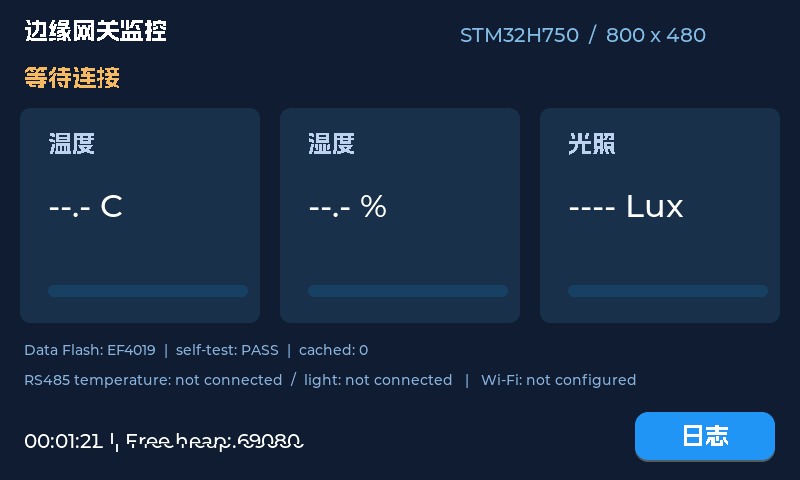

# 工业边缘网关 · 北极星 STM32H750 移植

将 [zgd-dev/-V2.0](https://github.com/zgd-dev/-V2.0) 的 FreeRTOS、LVGL、Wi-Fi MQTT、Modbus 采集、日志和离线缓存功能移植到正点原子北极星 H750，适配 4.3 英寸 RGB 800×480 触摸屏。硬件相关代码基于配套 H750 HAL 例程，协议与持久化逻辑重新整理为可测试模块。

当前固件不填充演示测量值。没有外接 Wi-Fi 或传感器时，屏幕正常运行，显示缺失状态。真实采集、云端上报和断网补传需要连接外设后继续验收。

## 已验证与待验证

- Keil MDK 5.39 / ARM Compiler 5.06 update 6：完整重建 0 errors，23 个上游 LVGL 编译警告。
- CMSIS-DAP：片内启动区与外部 QSPI 下载完成，`Verify OK / Application running`。
- SWD 读取：界面初始化 stage=5，LCD ID=0x4384，800×480；数据 Flash ID=0xEF4019，专用测试扇区读写通过，存储已启用；任务计数推进，无致命错误。
- 主机测试：CRC/Modbus/MQTT、AT 分片解析、缓存掉电恢复/损坏/读取故障、传感器字序、Flash 不可用时实时发送共 6 组通过。
- 屏幕实际观感、真实触摸、日志切换和息屏唤醒等待实物确认；详见 [验证记录](docs/verification.md)。
- ESP8266、RS485 传感器尚未连接，不能把编译通过或主机测试描述成这些链路已上板验证。

界面帧缓冲预览（SWD读取，非面板照片）：



## 从哪里开始

1. 看 [采购清单](docs/shopping-list.md)，当前还需 ESP8266 AT 模块、两个 RS485 Modbus 传感器和匹配供电/连接附件。
2. 按 [硬件与接线](docs/hardware-and-wiring.md) 接线，先让传感器单独通信，再启用 Wi-Fi。
3. 按下面的方法构建、下载，最后按 [验收步骤](docs/verification.md) 逐项检查。

## 构建与下载

环境：Windows、Keil MDK 5.39、ARM Compiler **5.06 update 6**、`Keil::STM32H7xx_DFP@4.1.3`。工程使用 QSPI 启动及 ARMCC scatter 文件，不直接切换为 ARM Compiler 6。

打开 `Projects/MDK-ARM/edge_gateway_h750.uvprojx`，选择目标 `gateway_h750`。也可以从仓库根目录运行：

```powershell
./scripts/build.ps1
./scripts/build.ps1 -Flash
# Keil 安装在其他目录时：
./scripts/build.ps1 -KeilRoot 'D:\Keil_v5'
```

生成 `artifacts/obj/edge_gateway_h750.axf` 与 `.hex`，日志在 `artifacts/build.txt` 和 `artifacts/flash.txt`。脚本将 Keil 的“仅有警告”退出码与真正错误区分，并要求下载日志含 `Verify OK`。

调试器选择 CMSIS-DAP / SWD，保留片内 STM32H7 与 `ATK-DNH750_QSPI_W25Q64JV.FLM` 两种下载算法。外部算法从[板厂资料盘](https://www.openedv.com/docs/boards/stm32/zdyz_stm32h750_polaris.html)取得，安装到 Keil `ARM/Flash`，不在本仓库重新分发。单独把 HEX 写入片内 Flash 无法运行完整应用。

## 私有配置

默认 SSID、密码、MQTT client ID 为空，网络关闭。新建被 Git 忽略的 `config/gateway_config.local.h`，例如：

```c
#define GW_WIFI_SSID "YOUR_2_4G_WIFI"
#define GW_WIFI_PASSWORD "YOUR_WIFI_PASSWORD"
#define GW_MQTT_CLIENT_ID "YOUR_OWN_CLIENT_ID"
#define GW_MQTT_TOPIC "stm32"
```

在 Keil 的 C/C++ Define 中追加 `GATEWAY_LOCAL_CONFIG` 后重建。不要提交这个文件。不要把云端 UID、Wi-Fi 密码或 HEX 中含有的凭据公开上传。

默认服务器 `bemfa.com:9501`，MQTT 3.1.1 QoS0；JSON 字段为 `temperature`、`shidu`、`light`，缺失测量值为 `null`。仅支持不要求 MQTT username/password 的当前协议配置。普通 TCP 没有 TLS，适合学习验证；部署前需要重新评估通信安全方案。SSID/密码不支持控制字符、双引号或反斜杠，单项最多 100 字节。

传感器地址、起始寄存器、温湿度位置、字节交换、光照高低字顺序及倍率都可以在同一私有头文件覆盖；默认值和取值说明见示例配置与接线文档。

## 存储与补传语义

代码在独立 8MB QSPI Flash；运行数据使用 SPI2 32MB W25Q256，保留前 24MB 原厂资源。后 8MB 中：`0x01800000` 的首个 4KB 扇区为自检；日志 `0x01801000..0x01C00000`；缓存 `0x01C00000..0x02000000`。

记录先写正文并校验，再提交 magic。读出不消费，ESP8266 返回 `SEND OK` 后才标记缓存记录已发。**这只确认模块的传输完成，不是云端持久化确认**；不确定发送会保留记录，允许重复，不能保证恰好一次。CRC 损坏的记录会被跳过，底层读取错误会使恢复失败，避免误认为空缓存。

缓存满时不覆盖未发记录。Flash 不可用/写失败时，采用仅保留最新等待样本的内存队列和一个发送重试槽；该降级路径断电不保存，积压期间可能丢失中间样本。当前时间戳为开机毫秒数，不是日期时间。

## 代码与测试

| 位置 | 内容 |
| --- | --- |
| `App/` | 可移植协议、NOR 记录、ESP AT 流解析、任务、界面、联网 |
| `Port/` | H750 UART/SPI/RS485/MPU/看门狗和 LVGL 显示触摸适配 |
| `Drivers/` | 正点原子 BSP/SYSTEM、ST HAL/CMSIS |
| `Middlewares/` | FreeRTOS 10.3.1、LVGL 8.3.11 |
| `User/` | 启动入口、IRQ、RTOS 配置、QSPI scatter |
| `tests/` | 编译生产 C 代码的主机行为测试 |

安装 Python 3 和 GCC 后运行 `python tests/test_core.py`；可用 `GATEWAY_HOST_CC` 指定 GCC 路径。可选安装 pyocd，用 `python scripts/read_diagnostics.py` 通过 DAP 读取诊断；`--framebuffer` 另存 RAM 中的屏幕图像，不等同于面板照片。

保留上游 MIT 许可和各第三方声明；详见 [THIRD_PARTY_NOTICES.md](THIRD_PARTY_NOTICES.md)。板厂 BSP 的版权和使用条件独立适用，不将它重新声明为 MIT。
