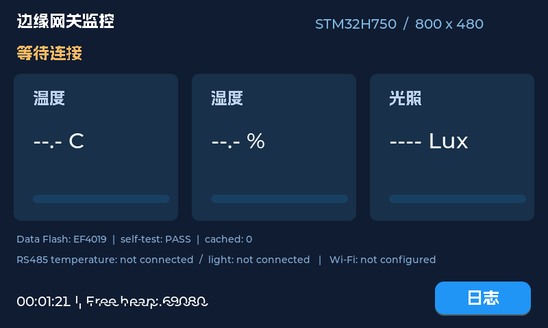

# 验证记录与后续验收

更新日期：2026-11-02。验证对象：用户连接的正点原子北极星 H750、4.3 英寸 RGB 800×480 屏、ATK CMSIS-DAP；未连接外部 Wi-Fi 和 RS485 传感器。

颜色修正版最终重建：Code=273776、RO=108888、RW=944、ZI=2290344字节；下载再次 `Verify OK`。之后两次读取 uptime=66987→141127ms、frames=1084→2260、polls=28→58，free_heap=69080、fatal=0、rx_overflows=0，证明修正版持续运行。内核CPUID=0x411FC271（Cortex-M7 r1p1）。保留的静态诊断快照见 [runtime-diagnostics.json](runtime-diagnostics.json)。

## 已观察到的证据

| 项目 | 结果 / 证据 |
| --- | --- |
| 完整重建 | ARMCC V5.06 update6 build750，MDK 5.39，H7 DFP4.1.3；0 errors、23 warnings |
| 下载 | 内部启动区和外部 QSPI 经 DAP 下载，日志 `Erase Done. Programming Done. Verify OK. Application running ...` |
| 核心测试 | `python tests/test_core.py` 六组通过，编译实际生产 C 代码，不是复制实现的伪测试 |
| UI 初始化 | SWD 读诊断 stage=5、LCD ID=0x4384、800×480，刷屏计数增长 |
| 数据 Flash | 0xEF4019（Winbond32MB）；selftest=1（PASS），storage_ready=1；仅在分配的自检扇区检查，未整片擦除 |
| 缺少外设 | 温湿度、光照有效标志均为0；Wi-Fi未配置，net=0；没有显示/缓存伪造测量 |
| 调度与堆 | 一次连续观察 uptime=226307ms、frames=3604、polls=93、空闲堆69080B，三个任务心跳跟进，fatal=0 |
| 颜色适配 | 从 SDRAM 读回帧缓冲，发现并修复上游 RGB565 字节交换配置；红/绿/蓝生产配置像素回归测试通过 |
| 串口 | COM5未收到调试输出，未把它当作运行失败；使用 SWD读取 RAM 交叉确认。实际 UART1 到 DAP VCOM 的连线未核实 |

`artifacts/build.txt`、`flash.txt`、`diagnostics.json`、`framebuffer.png` 为本地原始证据，生成文件不进入源码历史。诊断脚本使用 H743 的共有 H7 调试内存映射读取 H750 RAM，**不使用它的 Flash 算法进行烧写**。

帧缓冲图像只证明内存中的渲染内容；面板是否点亮、颜色观感、触摸坐标和实际唤醒仍需用户在实物上确认，不能由 `Verify OK` 推断。

## 代码审查修复

独立审查发现并修复四项问题，每项先加入会失败的行为测试，再修改实现：

1. 存储恢复遇到正文读取 I/O 错误时停止启用缓存，避免错误当作空缓存。
2. 重选缓存头时与恢复扫描一样验证完整 CRC，损坏中间记录不会阻塞后续有效记录。
3. Flash不可用或写入失败时走有界内存实时发送路径；成功入缓存的样本不重复进入此队列。
4. 温湿度寄存器位置、字节序与倍率、光照高低字顺序/倍率可配置，加入负温度、交换字节、低字在前的数值测试。

此外通过上板帧缓冲发现颜色问题，加入RGB565布局测试后修复。六组测试同时覆盖 CRC 错误/截断帧、MQTT长度边界、AT分片/粘连/二进制数据、缓存满不覆盖、提交中断恢复、分区越界等场景。

23个警告位于移入的LVGL代码（枚举类型混用、控制流跳过声明等）；未全局屏蔽警告。没有把“能编译”表述为长期可靠性认证。

## 当前板上待确认

- 接电后触摸屏幕唤醒，查看网关主界面；运行时间应持续增长。
- 点击“日志”，能看到启动和界面就绪日志；“返回”可回主界面。
- 约10秒不触摸后背光熄灭，再触摸应唤醒；检查四角坐标与按钮命中。
- 重新断电上电检查可自行启动，日志保留；不要在写入时拔下正在使用的存储板连接。

## 外设到齐后的验收（当前未完成）

1. 用独立 USB-RS485 或厂家工具逐只验证地址、波特率、寄存器及真实数值，分别设置地址1/2，然后按P9接线并连接同一总线。
2. 主界面数值应与参考仪表一致；拔掉某一只后仅对应数据失效，界面仍可操作，其他设备继续采集。
3. ESP8266 先通过串口确认 AT 固件和115200串口可用，再填入自己私有的 Wi-Fi/云端配置并重建；确认网络状态依次连接并到online。
4. 在自己的云端核对 JSON `temperature/shidu/light`；未接某设备的字段为null。不要使用上游作者的UID。
5. 网络断开时让真实传感器继续采集，观察cache_pending增加；恢复网络后确认缓存逐渐下降和云端收到积压数据。
6. 在有未发数据时重启，再核对缓存仍可补传。QoS0允许重复、不保证云端落盘，按业务需要去重。
7. Wi-Fi不存在、密码错误、设备无响应、缓存满时确认UI不死锁；缓存满拒绝覆盖未发记录，内存降级路径只保留有限最新数据，断电会丢失该部分。

硬件未到齐前，步骤1—7均不能声称实测通过。
